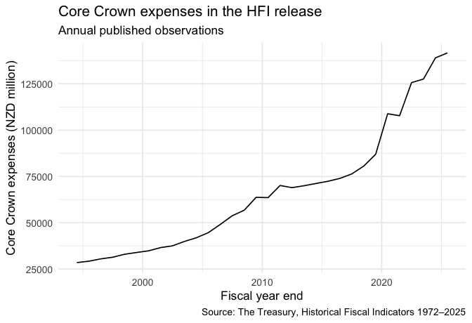

readfiscalnz
================

- [What data this package actually
  provides](#what-data-this-package-actually-provides)
- [Status and installation](#status-and-installation)
- [Retrieve and chart a time series](#retrieve-and-chart-a-time-series)
- [Inspect HFI output and canonical
  series](#inspect-hfi-output-and-canonical-series)
- [Output contract](#output-contract)
- [Common workflows](#common-workflows)
- [Network, terms, and cache
  behaviour](#network-terms-and-cache-behaviour)
- [Scope and limitations](#scope-and-limitations)
- [Troubleshooting](#troubleshooting)
- [Documentation, citation, and
  licensing](#documentation-citation-and-licensing)
- [Contributing and support](#contributing-and-support)

[](https://github.com/chartwell-macro/readfiscalnz)
[](https://opensource.org/license/mit)


`readfiscalnz` turns six specific New Zealand Treasury Excel
publications into validated, long-form R data. The supported material
includes two workbooks that contain long historical series, one
point-in-time set of monthly government accounts, and three separate
Economic and Fiscal Update forecast vintages.

The package retrieves an exact catalogued Treasury workbook or replays a
local copy, validates its structure, and preserves the accounting,
fiscal-year, consolidation, unit, forecast-vintage, and byte-level
provenance needed to interpret the observations. It is a curated
interface to the releases listed below, rather than a general search
interface to every dataset published by the Treasury.

## What data this package actually provides

The six `release_id` values identify **six publication artifacts**, not
six individual time-series observations. Some artifacts contain many
years of history; others are a snapshot of what the Treasury published
at one point in time.

**Short answer:** HFI and tax outturn are each one published snapshot of
a rolling, revised history. The package does not retain their earlier
workbook vintages. The monthly statements reader covers one
reporting-date snapshot. The EFU reader is the only one with multiple
supported publication vintages: PREFU 2023, HYEFU 2025, and BEFU 2026.

### Start with the reader that matches your question

- **Long-run annual fiscal data — `read_nz_hfi()`:** one HFI workbook
  with annual series across 1972–2025 on five sheets. Individual series
  can start later. Observation dates use March years through 1989 and
  June years from
  1990. Treasury can revise the rolling history, while the package pins
        this one published snapshot rather than archiving earlier HFI
        workbooks.
- **Monthly tax history — `read_nz_tax_outturn()`:** one tax-history
  workbook with `AllRevenue` accrual-revenue and `AllReceipts`
  cash-receipts sheets through May 2026. Starting dates vary by series.
  Treasury can revise the history; the package pins this snapshot and
  does not adjust or merge values from prior monthly publications.
- **Published monthly government accounts —
  `read_nz_monthly_financials()`:** one release, covering the eight
  months ended 28 February 2026. Its six sheets retain annual,
  year-to-date, actual, forecast, and variance roles. The reader does
  not merge separate monthly publications into a panel.
- **Fiscal and economic forecasts — `read_nz_efu()`:** three separate
  publication snapshots: PREFU 2023, HYEFU 2025, and BEFU 2026. Their
  fiscal, economic, and key-indicator sheets contain both actual or
  unaudited rows and forecast rows. `actual_forecast` and
  `forecast_horizon` preserve that source distinction; the reader does
  not interpolate between or revise vintages.

### Exact publications and files

- **Historical Fiscal Indicators:** `hfi-1972-2025` maps to
  `fiscaltimeseries1972-2025-year-end25.xlsx`. Its five supported sheets
  are Spending; Revenue and surplus measures; Debt and net worth; NZ
  Super Fund; and Nominal GDP. The pinned workbook produces 2,799
  long-form rows and is catalogued as current. Accounting changes are
  not necessarily backdated, so retain `regime_id`,
  `comparability_note`, and `restatement_status`.
- **Tax outturn:** `tax-outturn-2026-05` maps to
  `tax-history-may26.xlsx`. It produces 29,929 long-form rows and
  retains the distinction between accrual revenue and cash receipts,
  consolidation, and the June 2007 tax-write-off boundary. It is
  catalogued as current; monthly estimates may be revised and June
  results are independently audited.
- **Monthly financial statements:** `monthly-financials-2026-02` maps to
  `fsgnz-8mths-feb25.xlsx`. That is the exact Treasury filename even
  though the release title says “eight months ended 28 February 2026”.
  Its six supported statement surfaces produce 834 long-form rows. This
  catalogue row is superseded, but retained for reproducible replay.
- **Economic and Fiscal Updates:** `befu-2026`, `hyefu-2025`, and
  `prefu-2023` map to `befu26-charts-data.xlsx`,
  `hyefu25-charts-data.xlsx`, and `prefu23-charts-data.xlsx`. Their
  fiscal, economic, and key-indicator sheets produce 990, 1,018, and 996
  long-form rows respectively, with publication vintage, forecast
  horizon, actual/forecast status, and source units retained. BEFU 2026
  is current; HYEFU 2025 and PREFU 2023 are superseded but retained for
  vintage comparison and replay.

A catalogue status of `current` or `superseded` describes that exact
publication row. It does not cause the package to search for newer,
uncatalogued material.

``` r
library(readfiscalnz)

list_nz_fiscal_releases(status = "all")[c(
  "release_id", "family", "status", "file_name"
)]
#>                   release_id             family     status
#> 1              hfi-1972-2025                hfi    current
#> 2        tax-outturn-2026-05        tax_outturn    current
#> 3 monthly-financials-2026-02 monthly_financials superseded
#> 4                  befu-2026                efu    current
#> 5                 hyefu-2025                efu superseded
#> 6                 prefu-2023                efu superseded
#>                                   file_name
#> 1 fiscaltimeseries1972-2025-year-end25.xlsx
#> 2                    tax-history-may26.xlsx
#> 3                    fsgnz-8mths-feb25.xlsx
#> 4                   befu26-charts-data.xlsx
#> 5                  hyefu25-charts-data.xlsx
#> 6                  prefu23-charts-data.xlsx
```

### What source material does a reader parse?

Each reader has two production routes:

1.  **Official retrieval:** supply a `release_id`, omit `file`, review
    `nz_fiscal_terms()`, and set `accept_terms = TRUE`. The package
    resolves the catalogued Treasury URL and reuses an exact
    hash-addressed raw-cache entry when available; otherwise it
    downloads the original `.xlsx` file named above. It checks HTTPS
    routing, file signature, size, and the pinned SHA-256 before
    parsing.
2.  **Local replay:** supply the same `release_id` and `file =` a saved
    `.xlsx` workbook or a package-canonical `.csv`. This route performs
    no network request. The package records the actual local-file hash
    separately from the catalogue hash; equality of `raw_sha256` and
    `catalogue_sha256` confirms that a local file is the exact pinned
    Treasury workbook.

The package does **not** install the six full Treasury workbooks. It
installs one official-data subset solely for the deterministic worked
example: 32 annual `Core Crown Expenses` observations for 1994–2025,
selected without changing their values from the pinned HFI workbook. The
other small installed CSV files are synthetic schema examples, not
Treasury product data.

When comparing EFU vintages, retain `release_type`, `forecast_vintage`,
and `actual_forecast` so publication context is not lost.

## Status and installation

Version 0.1.0 is a pre-release GitHub version. The source repository is public and can be installed directly from GitHub. A CRAN release remains aspirational until accepted;
after acceptance, users can install the released package from CRAN.

Install the current GitHub version with `remotes`:

``` r
install.packages("remotes")
remotes::install_github("chartwell-macro/readfiscalnz")
```


Treasury data retrieval itself uses public official URLs and never
accepts a GitHub or Treasury credential.

For a reproducible build, pin `ref` to a reviewed tag or commit and
record the resulting package version and source revision in your project
lockfile. A future CRAN installation will be:

``` r
# Available only after a CRAN release is accepted:
# install.packages("readfiscalnz")
```

The default test suite and the examples below run offline. Package
loading performs no download, and local replay and public Treasury
retrieval require no data-service credential.

## Retrieve and chart a time series

**Input used below:** the installed file is a derived, 32-row canonical
CSV subset of official HFI `Core Crown Expenses` observations for
1994–2025. It is not the original Treasury XLSX. The values are
unchanged from the byte-pinned workbook and the source, transformation,
hash, and CC BY 4.0 attribution are documented under `inst/extdata`. The
live route shown later retrieves and parses the original workbook.

``` r
library(readfiscalnz)

snapshot <- system.file(
  "extdata", "hfi-core-crown-expenses-official.csv",
  package = "readfiscalnz",
  mustWork = TRUE
)

hfi_release <- list_nz_fiscal_releases(
  release_id = "hfi-1972-2025"
)

hfi_expenses <- read_nz_hfi(
  release_id = hfi_release$release_id[[1L]],
  file = snapshot,
  revision = "as_published",
  sheets = "Spending",
  cache_dir = tempfile("readfiscalnz-expenses-chart-cache-")
)

chart_data <- hfi_expenses[
  hfi_expenses$series == "Core Crown Expenses" &
    hfi_expenses$measure == "level",
  c("period_end", "value")
]
chart_data <- chart_data[
  order(chart_data$period_end),
  ,
  drop = FALSE
]
row.names(chart_data) <- NULL

utils::head(chart_data, 3L)
#>   period_end value
#> 1 1994-06-30 28476
#> 2 1995-06-30 29214
#> 3 1996-06-30 30483
```

The filtered data contain one published level series, so the plot uses
the returned `period_end` and numeric `value` fields directly. HFI spans
reporting regime changes; retain `regime_id` and `comparability_note`
from the full reader output when interpreting changes across those
boundaries. `ggplot2` remains a suggested package and is checked before
plotting.

``` r
if (requireNamespace("ggplot2", quietly = TRUE)) {
  ggplot2::ggplot(
    chart_data,
    ggplot2::aes(x = period_end, y = value)
  ) +
    ggplot2::geom_line() +
    ggplot2::labs(
      title = "Core Crown expenses in the HFI release",
      subtitle = "Annual published observations",
      x = "Fiscal year end",
      y = "Core Crown expenses (NZD million)",
      caption = "Source: The Treasury, Historical Fiscal Indicators 1972–2025"
    ) +
    ggplot2::theme_minimal(base_size = 13)
}
```



`nz_fiscal_provenance(hfi_expenses)` returns the exact snapshot and
source workbook hashes, parser and schema versions, and terms metadata.
Those details and the change notice are recorded in
`inst/extdata/README.md`. The source and attribution are [The
Treasury](https://www.treasury.govt.nz/publications/information-release/data-fiscal-time-series-historical-fiscal-indicators),
and the snapshot is provided under [CC BY
4.0](https://creativecommons.org/licenses/by/4.0/). For a live refresh,
inspect `nz_fiscal_terms("hfi-1972-2025")`, omit `file`, and pass
`accept_terms = TRUE`; bounded HTTPS, file-signature, size, and SHA-256
checks then run before parsing. The
`vignette("getting-started", package = "readfiscalnz")` article walks
through the same retrieval-to-chart path and the transition to official
source bytes.

## Inspect HFI output and canonical series

The HFI replay below uses another installed synthetic fixture to
demonstrate the exact output and series-identity contracts across fiscal
regimes.

``` r
hfi <- read_nz_hfi(
  file = fixture_path("hfi.csv"),
  sheets = "Spending",
  cache_dir = tempfile("readfiscalnz-hfi-cache-")
)

provenance <- nz_fiscal_provenance(hfi)
data.frame(
  class = paste(class(hfi), collapse = " / "),
  rows = nrow(hfi),
  period_end_class = paste(class(hfi$period_end), collapse = " / "),
  value_is_numeric = is.numeric(hfi$value),
  source_kind = provenance$source_kind,
  parser_version = provenance$parser_version,
  schema_version = provenance$schema_version
)
#>                         class rows period_end_class value_is_numeric
#> 1 nz_fiscal_data / data.frame    5             Date             TRUE
#>   source_kind parser_version schema_version
#> 1  local_file      hfi-2.0.0     hfi-long-2
```

Every reader returns a data frame with class
`c("nz_fiscal_data", "data.frame")`. The HFI example preserves the
source row order, gives `period_end` real `Date` values, and records the
raw snapshot hash and parser/schema versions in
`nz_fiscal_provenance(hfi)`.

The series helpers derive a structural identity from accounting basis,
consolidation, unit, fiscal regime, and other dimensions. The identity
is a lower-case SHA-256 string; it is not a display label and must be
obtained from the catalogue for the exact parsed object.

``` r
catalogue <- nz_fiscal_series_catalogue(hfi)
catalogue[c(
  "series_id", "series", "unit", "start_date", "end_date", "observations"
)]
#>                                                          series_id
#> 1 459c26c8a392092109a2a2d4b10ea20977e6a5e4ef08455bec51ffea3f0245a6
#> 2 cb6b769271be4f180f8a9f1c8629e5037a6b20fa11fc8466d5a3d1570afee0f6
#> 3 5d093f0dc78fc67763bdeba5dfba329ac186aced0dcc2ef3be2d6b9b22caf1f1
#> 4 eb56963021b5c502b0ee64ec242c6e6f47f7f09f9a59831b0d4ec865dca741b4
#> 5 f298722a9772e8ea67502ba66b7dc084dcf338fa44be66a7c05a1a445d28828b
#>                series        unit start_date   end_date observations
#> 1 Core Crown expenses NZD million 1986-03-31 1986-03-31            1
#> 2 Core Crown expenses NZD million 1987-03-31 1987-03-31            1
#> 3 Core Crown expenses NZD million 1990-06-30 1990-06-30            1
#> 4 Core Crown expenses NZD million 1994-06-30 1994-06-30            1
#> 5 Core Crown expenses NZD million 2005-06-30 2005-06-30            1

history <- nz_fiscal_series_history(hfi, catalogue$series_id[[1L]])
history[c("period_end", "series", "value")]
#>   period_end              series value
#> 1 1986-03-31 Core Crown expenses   101
```

The installed fixture intentionally spans fiscal-regime boundaries, so a
regime-aware identity can have a short history. On an official release,
identities normally contain the observations compatible with their
complete accounting and reporting regime.

## Output contract

All four readers return canonical columns in the order shown below. Each
has a numeric `value`, a `Date` observation column (`date` for tax
outturn and `period_end` otherwise), reset row names, and an
`nz_fiscal_provenance` attribute. The remaining fields are character
unless stated otherwise in the reference documentation.

| Reader | Observation field | Exact canonical columns |
|:---|:---|:---|
| `read_nz_hfi()` | `period_end` | `year`, `period_end`, `section`, `category`, `series`, `measure`, `value`, `unit`, `regime_id`, `fiscal_year_basis`, `accounting_basis`, `gst_treatment`, `consolidation_scope`, `comparability_note`, `restatement_status` |
| `read_nz_tax_outturn()` | `date` | `date`, `fiscal_year`, `measure`, `accounting_basis`, `consolidation_scope`, `section`, `series`, `value`, `unit`, `writeoff_regime` |
| `read_nz_monthly_financials()` | `period_end` | `table`, `statement_sheet`, `period_end`, `fiscal_year`, `period_kind`, `observation`, `actual_forecast`, `consolidation_scope`, `accounting_basis`, `section`, `series`, `note`, `value`, `unit` |
| `read_nz_efu()` | `period_end` | `release_type`, `forecast_vintage`, `forecast_horizon`, `dataset`, `sheet`, `year`, `period_end`, `fiscal_year_basis`, `actual_forecast`, `source_status_label`, `accounting_basis`, `consolidation_scope`, `section`, `series`, `value`, `unit`, `unit_multiplier`, `unit_context` |

`nz_fiscal_series_catalogue()` returns class
`c("nz_fiscal_series_catalogue", "data.frame")`. Its `series_id` is the
exact identity hash, while `identity_fields` and `identity_payload` are
list columns containing the fields used to construct it. The catalogue
also reports `start_date`, `end_date`, `observations`,
`finite_observations`, and the `nz-fiscal-series-1` contract version.
`nz_fiscal_series_history()` returns an `nz_fiscal_data` object sorted
by the appropriate observation date and retains the source rows,
point-level annotations, and provenance.

## Common workflows

### Select a release and read it

Start with the static catalogue rather than guessing a workbook URL:

``` r
current <- list_nz_fiscal_releases(status = "current")
terms <- nz_fiscal_terms("hfi-1972-2025")

# Local XLSX or canonical CSV replay. `file` means no network request.
hfi_local <- read_nz_hfi(
  release_id = "hfi-1972-2025",
  file = fixture_path("hfi.csv"),
  cache_dir = tempfile("readfiscalnz-local-cache-")
)
```

The same pattern applies to the other readers. These examples use the
installed synthetic fixtures and are intentionally small:

``` r
tax <- read_nz_tax_outturn(
  file = fixture_path("tax.csv"),
  measure = "both",
  cache_dir = tempfile("readfiscalnz-tax-cache-")
)
monthly <- read_nz_monthly_financials(
  file = fixture_path("monthly.csv"),
  table = "performance",
  cache_dir = tempfile("readfiscalnz-monthly-cache-")
)
efu <- read_nz_efu(
  file = fixture_path("efu.csv"),
  dataset = "fiscal",
  cache_dir = tempfile("readfiscalnz-efu-cache-")
)

data.frame(
  reader = c("tax outturn", "monthly financials", "EFU"),
  rows = c(nrow(tax), nrow(monthly), nrow(efu)),
  observation_field = c("date", "period_end", "period_end")
)
#>               reader rows observation_field
#> 1        tax outturn    4              date
#> 2 monthly financials    4        period_end
#> 3                EFU    2        period_end
```

For live retrieval, omit `file` and acknowledge the terms after
inspecting them. `accept_terms` is an explicit licence acknowledgement,
not a username, password, or authentication token:

``` r
nz_fiscal_terms("hfi-1972-2025")
hfi_live <- read_nz_hfi(
  release_id = "hfi-1972-2025",
  accept_terms = TRUE,
  timeout_sec = 30
)
```

### Build a stable history

Use the catalogue and history helpers instead of grouping only by a
displayed series name. The identity keeps semantically different
accounting or forecast series apart:

``` r
series_catalogue <- nz_fiscal_series_catalogue(hfi)
series_id <- series_catalogue$series_id[[1L]]
series_history <- nz_fiscal_series_history(hfi, series_id)

series_history[c("period_end", "series", "value", "unit")]
```

For chart or application output, use the returned observation field and
`value`; keep the other columns and the provenance attribute when the
semantic context matters. Join histories across releases only when their
canonical identity and release-vintage semantics are compatible.

### Inspect provenance and replay bytes

Each read records the release identity, official landing and source
URLs, terms, revision policy, parser/schema versions, raw snapshot path,
size, and SHA-256. The raw snapshot is copied into a content-addressed
cache before it is parsed:

``` r
prov <- nz_fiscal_provenance(hfi)
prov[c(
  "release_id", "source_kind", "raw_size_bytes", "raw_sha256",
  "parser_version", "schema_version", "revision_policy"
)]

raw <- nz_fiscal_raw_bytes(hfi)
stopifnot(length(raw) == prov$raw_size_bytes)
```

`nz_fiscal_raw_bytes()` verifies the cached file against the recorded
hash before reading it. If a long-running environment accumulates
snapshots, `prune_nz_fiscal_cache()` applies file-count, byte, and age
bounds:

``` r
cache <- tempfile("readfiscalnz-prune-cache-")
dir.create(cache)
prune_nz_fiscal_cache(cache, max_files = 64, max_bytes = 250 * 1024^2)
```

## Network, terms, and cache behaviour

- With `file =` supplied, the package performs no network I/O. It
  accepts an existing `.xlsx` workbook or canonical `.csv`, checks its
  file signature and size, archives the exact bytes, and sends the
  artifact through the same schema validation path.
- With `file = NULL`, the selected catalogue URL is fetched only after
  `accept_terms = TRUE`. The request starts from a catalogued HTTPS
  Treasury URL. Redirects are restricted to HTTPS, and the final
  effective URL must remain on the Treasury host. `timeout_sec` applies
  per attempt; retries are bounded to at most three attempts, and
  artifact size is bounded. A SHA-256 mismatch is a release/catalogue
  review condition, not a reason to parse changed bytes.
- Raw snapshots are stored below
  `tools::R_user_dir("readfiscalnz", "cache")/v1` by default. Parsed
  results are held in a bounded in-memory cache. Override
  `readfiscalnz.cache_dir` or pass `cache_dir =` for an isolated job,
  test, or offline replay.
- The cache limits can be tuned with `readfiscalnz.parsed_cache_entries`
  (16), `readfiscalnz.raw_cache_files` (64),
  `readfiscalnz.raw_cache_bytes` (250 MiB),
  `readfiscalnz.raw_cache_max_age_days` (180), and
  `readfiscalnz.download_attempts` (up to 3). Use a separate temporary
  cache for independent parallel jobs when their lifecycle should not
  overlap.

The package does not download on startup. By default it does not write
to the project or working directory; it writes below the managed user
cache. It can write elsewhere when the caller explicitly chooses that
location through `cache_dir` or `readfiscalnz.cache_dir`. It never
silently substitutes an unverified workbook. A missing network, changed
official artifact, absent workbook sheet, or schema mismatch fails
explicitly so that the caller can decide how to recover.

## Scope and limitations

The package’s reviewed scope is part of its reproducibility contract:

- Only the six release identities and mapped surfaces listed above are
  supported. Future Treasury releases or changed workbook tabs require a
  reviewed catalogue/parser update; they are not accepted automatically.
- HFI is a historical series across multiple fiscal-year, accounting,
  GST, consolidation, and reporting regimes. `regime_id`,
  `comparability_note`, and `restatement_status` must be considered
  before comparing levels over a break.
- Tax revenue is accrual and tax receipts are cash. Consolidation
  eliminations, core Crown totals, and whole-of-government totals are
  distinct rows; revenue write-offs are explicitly marked from June
  2007.
- Monthly statements retain observation roles such as annual,
  year-to-date, actual, forecast, and variance. EFU values retain
  publication vintage, source status, units, and unit multipliers. These
  are not interchangeable measures.
- The readers normalise and validate mapped source data; they do not
  provide seasonal adjustment, forecasting, imputation, or an
  alternative accounting interpretation.
- Release metadata and source terms are recorded per release. Treasury
  data remain subject to the terms on the official release page, even
  when the bytes are replayed from a local cache.

## Troubleshooting

| Symptom | What to check |
|:---|:---|
| `Live retrieval requires accept_terms = TRUE` | Review `nz_fiscal_terms(release_id)` and the linked Treasury terms, then pass `accept_terms = TRUE` deliberately. Use `file =` for offline work. |
| `file must identify one existing XLSX or CSV artifact` | Confirm the path exists, has an `.xlsx` or `.csv` extension, is non-empty, and is readable by the current process. |
| A workbook reports a missing sheet or schema mismatch | Verify that the selected release and `sheets`, `table`, or `dataset` route match the published workbook. Do not rename columns or silently coerce a changed workbook; investigate the release first. |
| Official artifact SHA-256 drifted | The published bytes changed relative to the package catalogue. Keep the evidence, avoid parsing the changed artifact as the pinned release, and wait for a catalogue review or use the previously archived snapshot. |
| `series_id is absent from the parsed fiscal release` | Rebuild `nz_fiscal_series_catalogue()` from the exact object and use one of its lower-case 64-character IDs. IDs hash the contract version, family, and family-specific identity payload—not observation values, source bytes, or `release_id`. The same ID can recur across releases when every contracted identity field matches. |
| Raw bytes are unavailable or the cache is corrupt | Re-run with the original local file or a new temporary `cache_dir`; then inspect `nz_fiscal_provenance()` and verify the new SHA-256. |
| A live call times out or the host is unavailable | Use a bounded `timeout_sec`, retry later, or obtain the official workbook separately and replay it with `file =`. The offline fixture path is suitable for tests and documentation builds. |

## Documentation, citation, and licensing

The task-oriented vignettes cover the complete offline workflow, release
terms and provenance, cache boundaries, and troubleshooting/validation:

- `vignette("getting-started", package = "readfiscalnz")`
- `vignette("sources-provenance-caching", package = "readfiscalnz")`
- `vignette("troubleshooting", package = "readfiscalnz")`

After installation, run `citation("readfiscalnz")` for the package
citation. The package author and maintainer display is [Chartwell
F](https://github.com/chartwell-macro). Citation metadata is maintained in
`inst/CITATION` for R and `CITATION.cff` for repository tooling.

**Package code and documentation:** MIT licence, copyright Chartwell Macro, as
recorded in the [repository
LICENSE](https://github.com/chartwell-macro/readfiscalnz/blob/HEAD/LICENSE).
The package-generated synthetic fixtures use the same package licence.

**Source data and official publications:** the official Treasury
artifacts are not relicensed by the package or assigned to Chartwell Macro. The
catalogue records the terms and attribution for each release, currently
including Crown Copyright and CC BY 4.0 attribution to The Treasury.
Inspect `nz_fiscal_terms()` and the [recorded source
terms](https://github.com/chartwell-macro/readfiscalnz/blob/HEAD/inst/TERMS.md)
before redistributing source bytes or derived material. Images and other
third-party material may have separate rights.

## Contributing and support

Please read [CONTRIBUTING.md](CONTRIBUTING.md) before opening a change.
New parsers and catalogue rows should include deterministic fixtures,
schema and provenance assertions, an offline path, and an explanation of
any source-term or compatibility decision. Keep generated `README.md`,
`man/`, `NAMESPACE`, and the pkgdown site synchronized from their source
files according to the repository workflow.

Use the [chartwellmacro@gmail.com](mailto:chartwellmacro@gmail.com) for
reproducible bug reports and release/source drift. Include the package
version, R version, operating system, reader, release ID, whether the
input was local or live, and the non-secret error text. Do not include
credentials, private URLs, or unredacted cache contents.
